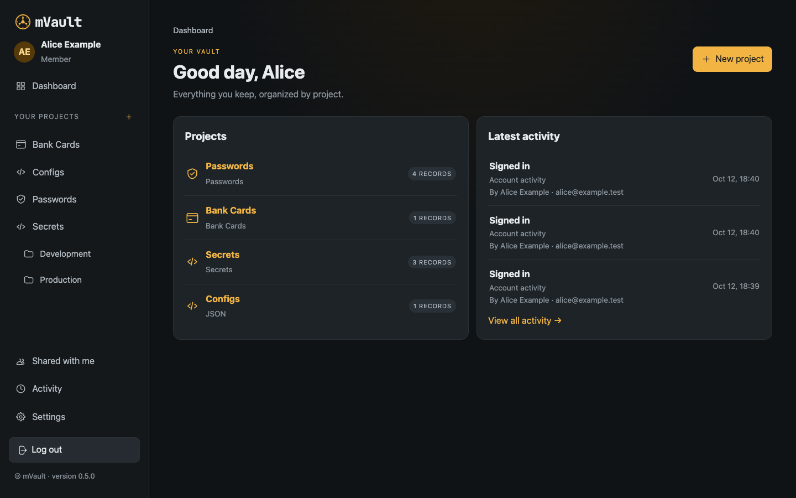
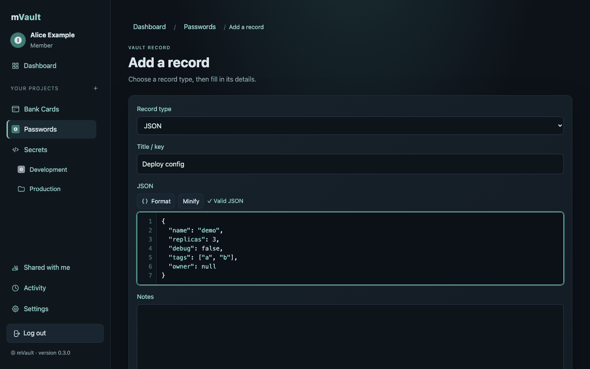
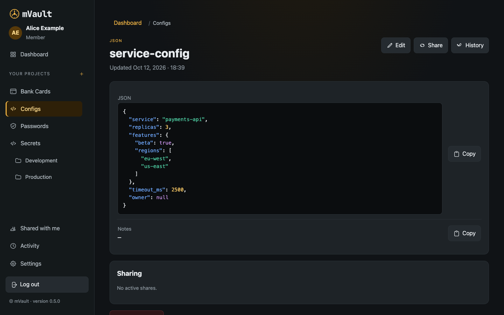
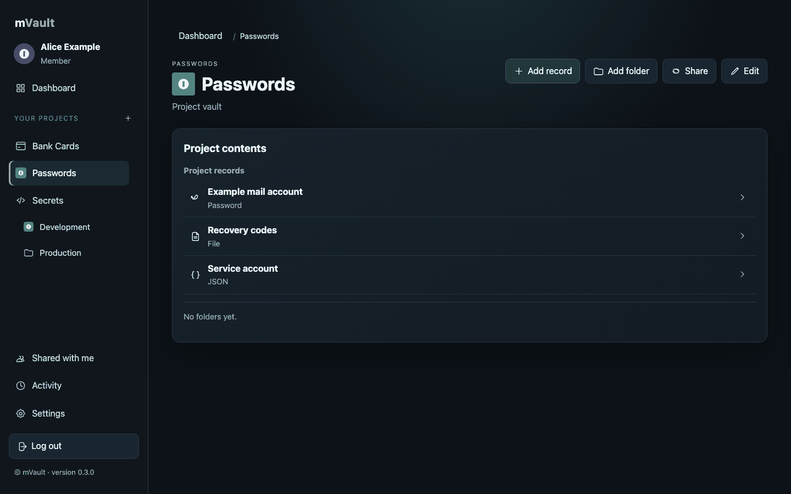
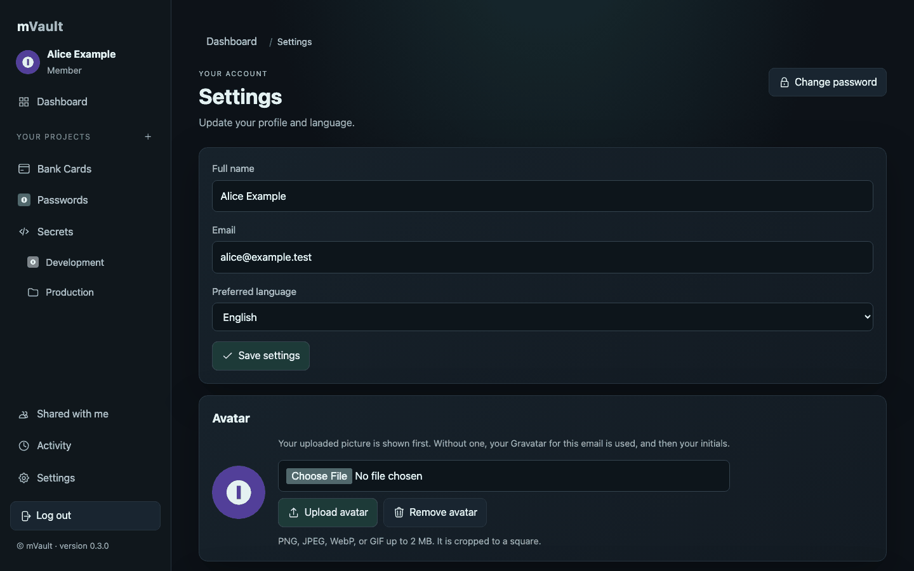

<p align="center">
  <picture>
    <source media="(prefers-color-scheme: dark)" srcset="docs/images/logo-dark.svg">
    
  </picture>
</p>
<p align="center"><b>A self-hosted family vault for passwords, bank cards, secrets, JSON and files.</b><br>Encrypted at rest. Runs from one container, or on the PostgreSQL and MinIO you already have.</p>

<p align="center">
  <a href="https://github.com/orkhan/mvault/actions/workflows/ci.yml"></a>
  <a href="https://github.com/orkhan/mvault/releases"></a>
  <a href="https://github.com/orkhan/mvault/pkgs/container/mvault"></a>
  <a href="LICENSE"></a>
</p>

> **Security note:** mVault has **not been independently audited**. Encryption at rest protects database leaks and backups, but the key lives next to the app, so anyone who controls the running host can read everything. Read [Security](docs/security.md) before storing anything you cannot afford to lose.
>
> **Status:** v0.7.0 improves the click-to-fill Chrome extension with usernames and a scrollable list of matching password records. The application has run in a homelab since 0.1.0; v0.4.0 was the first public release, so please report anything odd as an issue.

mVault keeps a family's sensitive things in one private place: logins, bank cards, environment variables and API keys, JSON documents and scanned files. Everything is organised as *member → project → folder → record*, values are encrypted before they reach the database, and sharing is explicit and read-only. It is a small Django application with an optional click-to-fill Chrome extension; it has no cloud service or telemetry.

<p align="center">
  
</p>

<table>
  <tr>
    <td width="50%"><br><sub>JSON editor: line numbers, highlighting, validation, format/minify</sub></td>
    <td width="50%"><br><sub>JSON record, prettified, with copy</sub></td>
  </tr>
  <tr>
    <td><br><sub>Projects hold any mix of record types; custom icons and the active project in the sidebar</sub></td>
    <td><br><sub>Settings: avatar (upload, Gravatar, initials), export all data</sub></td>
  </tr>
</table>

<sub>Screenshots use fake demo data generated by `manage.py seed_local`.</sub>

## Features

- **Projects and folders** – group records the way you think about them; folders sit directly under a project (for example, environments such as `Dev`/`Prod` in a secrets project).
- **Record types** – *password*, *bank card*, *environment variable* (with `.env` import/export), **JSON** (editor with line numbers, syntax highlighting, validation, format/minify, prettified view) and **files** up to 50 MB. JSON and file records can be added to any project.
- **Masked values** – passwords, card numbers, CVV, PIN and secret variables are hidden until revealed; reveal and copy actions are written to the audit log.
- **Custom icons and avatars** – upload an icon per project/folder and a personal avatar. Avatar order: your upload, then your [Gravatar](https://gravatar.com), then your initials.
- **Sharing** – share a whole project or single records with another member, read-only and live. Recipients can copy a shared record into their own vault.
- **Browser autofill (Chrome for now)** – the [Chrome extension](docs/chrome-extension.md) fills a selected password record's username and password on an exact hostname match. It uses the signed-in mVault session and does not submit forms.
- **History and audit** – every record keeps its revisions; a paginated activity log shows who did what.
- **Export everything** – *Settings → Export all data* downloads a ZIP shaped like your tree, with a CSV of decrypted values per folder and file records as the original files. (It contains secrets in plain text; guard it.)
- **Encryption at rest** – record values, history and attachment metadata are stored as AES-256-GCM ciphertext; see [Security](docs/security.md) for exactly what is and isn't covered.
- **Admin-managed accounts** – no self-registration. An administrator creates members, resets passwords, deactivates or deletes accounts (transfer or purge). The administrator has no vault of their own and cannot read members' records through the app.
- **Multilingual** interface (English, Russian, Azerbaijani, Turkish, Spanish, Belarusian, Ukrainian), chosen per member.
- **Hardened by default** – Argon2id password hashes, sign-in throttling, a Content-Security-Policy, secure cookies and HSTS when served over HTTPS.

## Why mVault

- It stays small: one Python app, PostgreSQL, and optional S3-compatible storage for files and images.
- It fits a homelab: one container with everything inside, or just the app pointed at the PostgreSQL and MinIO you already run. The reverse proxy is yours (Nginx Proxy Manager, Caddy, Traefik, nginx, …).
- It is honest about limits: the server can decrypt records, and browser autofill is user initiated. See the [FAQ](docs/faq.md) and [Security](docs/security.md).

## Quick start (Docker, all-in-one)

```bash
docker run -d --name mvault -p 8000:8000 -v mvault-data:/data \
  -e MVAULT_BASE_URL=http://localhost:8000 ghcr.io/orkhan/mvault:latest
docker logs mvault        # prints the first-start admin e-mail and a generated password
# open http://localhost:8000 and sign in; you are asked to change the password
```

Prefer Compose? Use [`compose.yaml`](compose.yaml): `docker compose up -d`. Back up the `mvault-data` volume: it contains the database, the files **and the encryption key** (see [Backup & restore](docs/backup-restore.md)).

## Install options

### Chrome extension

Chrome is the only supported browser for now. Download the `mvault-chrome-extension-<version>.zip` asset from the [latest GitHub release](https://github.com/orkhan/mvault/releases/latest), extract it, then open `chrome://extensions`, enable **Developer mode**, and choose **Load unpacked**. Select the extracted folder containing `manifest.json`. Continue with the [extension setup guide](docs/chrome-extension.md) to connect your mVault server.

| Option | Best for | PostgreSQL / MinIO | Guide |
|---|---|---|---|
| **Docker all-in-one** `ghcr.io/orkhan/mvault:<version>` | Trying it out, small servers, Raspberry Pi (amd64 + arm64) | Embedded, started automatically | [Installation](docs/installation.md#1-docker-all-in-one) |
| **Docker slim** `ghcr.io/orkhan/mvault:<version>-slim` | You already run PostgreSQL and MinIO/S3 | Yours; set `DATABASE_URL`, `S3_*` | [Installation](docs/installation.md#2-docker-slim-with-your-own-postgresql-and-minio) |
| **Native Linux / macOS** `curl … \| sh` | No Docker: VMs, bare metal, LXC, a Mac | Installed alongside, or skipped | [Native install](docs/native-install.md) *(v0.4.0)* |
| **Proxmox LXC** helper script | Proxmox VE hosts | Inside the container, no Docker | [Proxmox](docs/proxmox.md) |

The all-in-one image skips its embedded PostgreSQL when you set `DB_HOST`/`DATABASE_URL`, and its embedded MinIO when you set `S3_ENDPOINT_URL`, so you can mix and match.

## Configuration highlights

| Variable | Purpose |
|---|---|
| `MVAULT_BASE_URL` | Public URL (`https://vault.example.com`). Drives allowed hosts, CSRF origin, secure cookies, HSTS. |
| `MVAULT_ENCRYPTION_KEY`, `MVAULT_ENCRYPTION_SALT` | Encrypt stored values. Generated for you in the all-in-one image; **required** (and yours to back up) with an external database. |
| `DATABASE_URL` or `DB_*` | Use your own PostgreSQL (14+). |
| `S3_ENDPOINT_URL`, `S3_ACCESS_KEY`, `S3_SECRET_KEY` | Use your own S3-compatible storage. Without storage, uploads are disabled. |
| `MVAULT_ADMIN_EMAIL`, `MVAULT_ADMIN_PASSWORD` | First administrator. |

Every option, including `*_FILE` variants for Docker secrets, is in the [configuration reference](docs/configuration.md).

## Reverse proxy

mVault does **not** bundle one. Serve it over HTTPS with the proxy you like and forward `Host`, `X-Forwarded-Proto` and `X-Forwarded-For`. Allow request bodies of at least 55 MB and timeouts of at least 120 s so file uploads work. Ready-made snippets for Nginx Proxy Manager, Caddy, Traefik and nginx are in [Reverse proxy](docs/reverse-proxy.md).

## Security in short

- Values are encrypted in the database with a key derived (scrypt) from two secrets you control. A stolen database dump or disk image **without** those secrets exposes ciphertext only.
- The key lives next to the app, so someone who controls the running host can read everything. Titles, project/folder names, e-mail addresses and the audit log are **not** encrypted, and attachment bytes rely on the private storage bucket rather than separate encryption.
- It has not been independently audited. Read [Security](docs/security.md), and report problems privately via [GitHub security advisories](https://github.com/orkhan/mvault/security/advisories/new).

> ⚠️ **Back up your encryption key and salt.** If you lose them, your stored values cannot be recovered. Keep them in a password manager that is *not* mVault.

## Upgrading

Pull the new image tag and recreate the container; migrations run automatically at start. Take a backup first and read [Upgrading](docs/upgrading.md) — it includes the notes for moving from 0.3.x to 0.4.

## Development

```bash
git clone https://github.com/orkhan/mvault && cd mvault
cp .env.local.example .env.local          # point it at a local PostgreSQL
uv run --python 3.12 --with-requirements requirements.txt python manage.py test
```

Details (local database, seed data, project layout) are in [Development](docs/development.md). Contributors and coding agents: see [CONTRIBUTING.md](CONTRIBUTING.md) and [AGENTS.md](AGENTS.md).

## Roadmap

Release work for v0.4.0 is tracked in [PLAN.md](PLAN.md): multi-arch images, the native installer, the Proxmox script, CI. Ideas beyond that, with no promises: two-factor sign-in, an encryption-key rotation screen, importing from other password managers, per-file encryption, more languages.

## Contributing and license

Issues and pull requests are welcome — start with [CONTRIBUTING.md](CONTRIBUTING.md) and the [Code of Conduct](CODE_OF_CONDUCT.md). mVault is released under the [MIT License](LICENSE). The all-in-one image also contains PostgreSQL (PostgreSQL License) and MinIO (AGPL-3.0); their licenses ship in `/licenses`.
