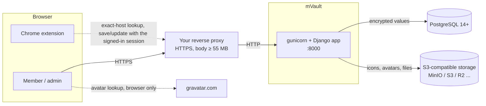
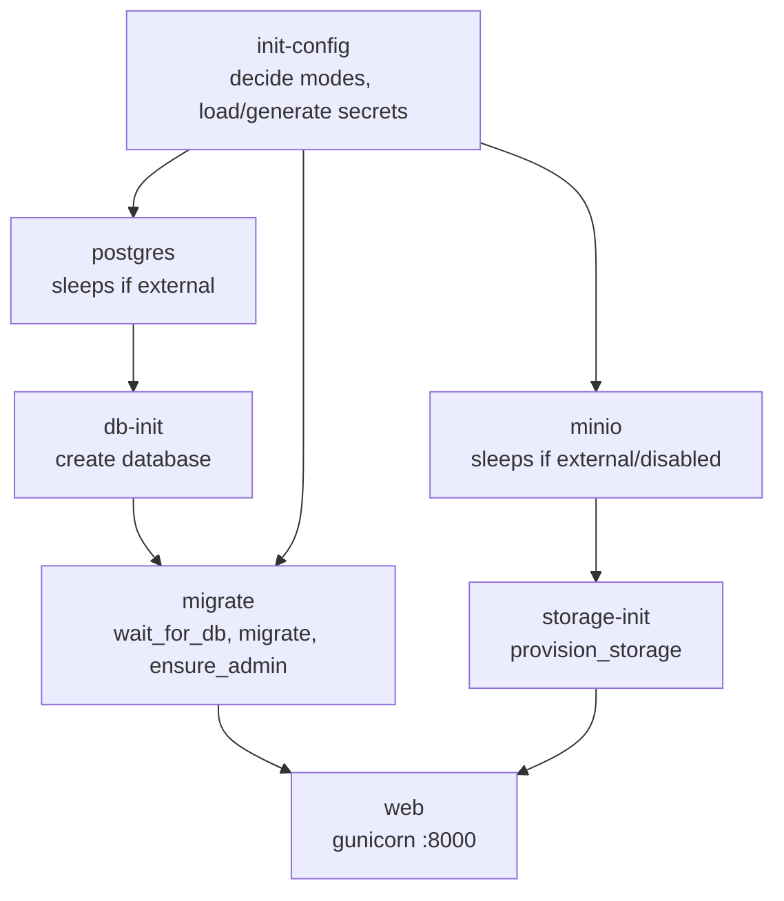

# Architecture

mVault is a single Django application (Python 3.12) backed by PostgreSQL, with optional S3-compatible storage. There is no separate front end: pages are server-rendered with a little inline JavaScript.

## Components and modes



The optional Chrome extension rides the member's signed-in browser session: lookups are plain session-cookie requests (or same-origin requests from an open mVault tab), writes always go through an mVault tab so Django's CSRF check applies. The app returns credentials only after an exact-host match and the normal record access check, and the save endpoints write only to records and projects the member owns. See [Chrome extension](chrome-extension.md).

| Component | All-in-one image | Slim image / native / your infra |
|---|---|---|
| App | Included | Included |
| PostgreSQL | Embedded 15 on `127.0.0.1`, data `/data/postgres` | **Yours** (`DATABASE_URL` / `DB_*`) |
| Object storage | Embedded MinIO on `127.0.0.1:9000`, data `/data/minio` | **Yours** (`S3_*`), or none |
| Reverse proxy | **Not included** | **Not included** |

The app decides nothing about "modes" itself: it connects to whatever `DATABASE_URL`/`S3_*` say. The all-in-one image's startup scripts only decide whether to *also start* PostgreSQL and MinIO.

## Process layout in the all-in-one image

[s6-overlay](https://github.com/just-containers/s6-overlay) is PID 1 and starts services in dependency order (`docker/rootfs/etc/s6-overlay/`):



`init-config` writes values into `/run/s6/container_environment` so later services see them. The slim image skips all of this: `docker/entrypoint.sh` waits for the database, migrates, ensures the admin and starts gunicorn.

## Data model

```
User ─┬─< Project ─┬─< Folder
      │            └─< Record >─ Attachment (file records)
      │                  ├─< RecordRevision (encrypted history)
      │                  └─< RecordShare        ProjectShare >─ Project
      └─< AuditEvent                             LoginAttempt (throttling)
```

- A **project** has a type (`password_vault`, `bank_cards_vault`, `secret_vault`; legacy `json_vault`/`file_vault` still work) that decides its primary record type. JSON and file records can be added to every project. Secret projects keep records inside environment folders.
- `Record.data`, `RecordRevision.snapshot` and `Attachment.meta` use `EncryptedJSONField` (`mvault_app/fields.py`, `crypto.py`): JSON → AES-256-GCM → text column.
- Deleting a record, folder or project is a soft delete that keeps history; file records additionally delete their stored objects.

## Data flow

**Icons and avatars.** Upload → validated and normalised to PNG with Pillow (128 px icons, 256 px square avatars) → stored in the icons/avatars bucket. The page references `/media/icons/<key>` or `/media/avatars/<key>`; the app checks that the visitor is signed in and streams the object. If `ICONS_PUBLIC_BASE_URL`/`AVATARS_PUBLIC_BASE_URL` are set the page links to that public bucket URL instead.

**Files.** Upload (≤ 50 MB) → SHA-256 computed → stored in the private attachments bucket under a random key → an `Attachment` row records size, checksum and encrypted name/type. Download (`/records/<id>/download/`) checks ownership or a share, audits it, and streams the object as an attachment. Replacing a file keeps the old object; deleting the record deletes all of its objects.

**Values.** Forms → `Record.data` → encrypted when saved, decrypted when loaded. Masked fields are filled in by `/records/<id>/value/` only when the user reveals or copies, and that is audited.

## Code layout

```
mvault_project/   settings (all env parsing), urls, wsgi
mvault_app/       models, views, forms, crypto/fields, storage, throttle, middleware, templates, tests
  management/commands/   check_config, ensure_admin, provision_storage, rotate_encryption_key, seed_local, wait_for_db
  templatetags/mvault_i18n.py   icons, avatar, entity_icon, RU translations (other languages: locales/)
  migrations/     0001 … (0004–0006 introduce encryption; all reversible)
docker/           entrypoint.sh (slim) and rootfs/ (s6 services for the all-in-one image)
Dockerfile        targets: slim, aio
```
